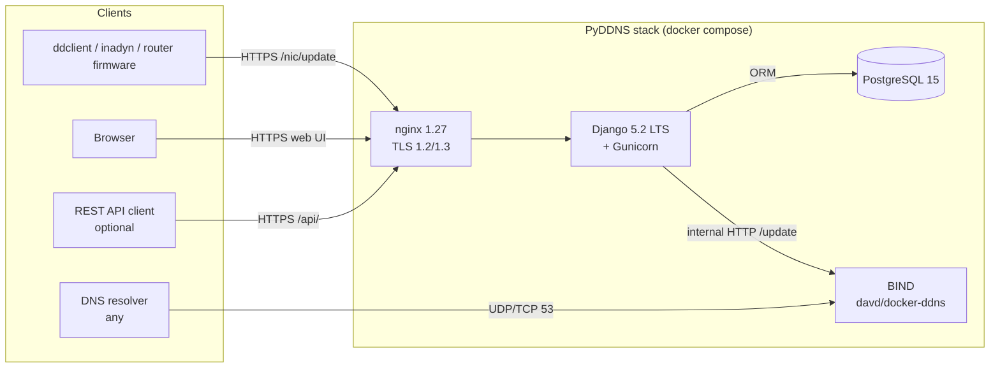

<div align="center">

# PyDDNS

**Self-hosted Dynamic DNS server. Run your own `dyndns2`-compatible service — no vendor lock-in, no rate limits, no monthly fees.**

[](https://github.com/olimpo88/PyDDNS/actions/workflows/test.yml)
[](https://www.gnu.org/licenses/agpl-3.0)
[](https://www.python.org)
[](https://www.djangoproject.com)
[](https://www.postgresql.org)
[](https://www.docker.com)

[Quick Start](#-quick-start) · [Features](#-features) · [Screenshots](#-screenshots) · [REST API](#-rest-api-optional) · [Roadmap](#-roadmap) · [Contributing](#-contributing)

</div>

---

## 🌟 Why PyDDNS?

Public Dynamic DNS providers come with caveats: rate limits, paid tiers, branded subdomains, and data you don't own. **PyDDNS** is the self-hosted, production-ready alternative — a complete DDNS solution wrapped in a clean web UI and one-command Docker deployment.

Point a delegated subdomain at your server, create user accounts, and let users update their public IP from any standard `dyndns2` client — router firmware, `ddclient`, `inadyn`, mobile apps. DNS lives in your own BIND zone, activity is fully audited, access is gated per-user, and a Token-authenticated REST API is one env-var away.

---

## 🖼 Screenshots

<div align="center">


*Dashboard — public IP, owned subdomains with 24h uptime sparklines, recent activity log with filters, and a ddclient/curl quickstart.*

<br/>


*Login — language picker exposed when no operator-level lock is set.*

<br/>


*Users — admin overview with per-user domain count and last-sync time.*

</div>

---

## ✨ Features

- 🔌 **`dyndns2` protocol compatible** — drop-in replacement for No-IP, DynDNS, Duck DNS for any existing client (`ddclient`, `inadyn`, router firmware)
- 🔑 **Token-authenticated REST API** (optional, opt-in) — full CRUD over users, subdomains, activity log, with per-token revocation
- 👥 **Multi-user, multi-domain** — admin panel, per-user subdomains, role-based permissions, soft-delete prevention for the current user
- 🎭 **Admin impersonation** — superusers can sign in as any active account (with a sticky banner and full audit trail) for support and debugging without needing the user's password
- 🔐 **Two-factor authentication (TOTP)** — optional for every user (authenticator app + one-time backup codes), mandatory for admins with a single env var (`ADMIN_FORCE_2FA=1`); also guards `/admin`
- 📧 **Password reset by email** (toggleable) — built-in self-service flow with localized email templates. Operators that prefer admin-controlled credentials can disable it with a single env var
- 🎨 **Modern dark UI** — responsive Django templates + Alpine.js, no SPA build pipeline. Amber accent palette, Inter for UI, JetBrains Mono for technical data
- 🌍 **8 languages out of the box** — 🇺🇸 English · 🇪🇸 Spanish · 🇧🇷 Portuguese (Brazilian) · 🇫🇷 French · 🇩🇪 German · 🇷🇺 Russian · 🇯🇵 Japanese · 🇨🇳 Chinese (Simplified). Browser auto-detection, in-app picker, or operator-locked mode
- 🔐 **Production-grade security** — Argon2id password hashing (PBKDF2 fallback), HSTS, secure cookies, CSP-friendly, hardened headers, env-driven secrets, brute-force throttle (per-IP and per-user), input validation
- 📊 **Full audit trail** — every IP update, login attempt, and admin action persisted to Postgres with timestamps, agent strings, and return codes
- 🛡 **Container hardening** — multi-stage build, non-root user, read-only root filesystem, dropped capabilities, no-new-privileges
- 🩺 **Healthchecks everywhere** — Postgres `pg_isready`, Gunicorn TCP probe, `depends_on: service_healthy` gates startup order
- 🧪 **Tested in CI** — pytest suite (125+ tests), GitHub Actions on every push with `pip-audit` for CVE scanning, `ruff` for lint
- 🔄 **Smooth upgrades** — scripted Postgres 9.6 → 15 migration runs both versions in parallel via a separate Compose overlay file
- 🧰 **One-command deployment** — `docker compose up -d` and you're live

---

## 🛠 Tech Stack

| Layer | Technology |
|-------|-----------|
| Backend | [Django 5.2 LTS](https://www.djangoproject.com) on [Python 3.11](https://www.python.org) |
| WSGI | [Gunicorn 23](https://gunicorn.org) — 3 workers in production, `--reload` in development |
| Frontend | Server-rendered Django templates + [Alpine.js](https://alpinejs.dev) for interactivity |
| Design tokens | Inter (UI), JetBrains Mono (data), oklch palette, dark mode by default |
| REST API | [Django REST framework](https://www.django-rest-framework.org) (optional, gated by `ENABLE_REST_API`) |
| DNS | [BIND](https://www.isc.org/bind/) via [`davd/docker-ddns`](https://hub.docker.com/r/davd/docker-ddns) |
| Database | [PostgreSQL 15](https://www.postgresql.org) |
| Reverse Proxy | [nginx 1.27](https://nginx.org) — TLS 1.2/1.3, modern ciphers, security headers |
| Orchestration | [Docker Compose v2](https://docs.docker.com/compose/) — multi-stage build, hardened runtime |
| Auth | Sessions for web UI, Token for REST API, HTTP Basic for `dyndns2` |
| Hashing | Argon2id (with `argon2-cffi`), PBKDF2 fallback |
| Testing | [pytest](https://pytest.org), [pytest-django](https://pytest-django.readthedocs.io), [pytest-env](https://pypi.org/project/pytest-env/), [ruff](https://docs.astral.sh/ruff/) |
| CI | [GitHub Actions](https://github.com/features/actions) — tests + lint + `pip-audit` on every push |

---

## 🏛 Architecture



- **Clients** speak the standard `dyndns2` protocol over HTTPS, the web UI in a browser, or the optional Token-authenticated REST API. DNS queries from the wider internet hit BIND directly on port 53.
- **nginx** terminates TLS, serves static assets, and reverse-proxies dynamic requests to Django.
- **Django + Gunicorn** handle authentication, validate updates, persist the audit trail to Postgres, and call BIND's internal HTTP API to mutate the zone.
- **BIND** holds the live zone file in `data/bind-data/` and answers public DNS queries.
- All internal traffic between containers stays on a private Compose network — only ports 53, 80, and 443 are exposed to the host.

---

## 🚀 Quick Start

### Prerequisites

- [Docker](https://docs.docker.com/install/) and [Docker Compose v2](https://docs.docker.com/compose/install/)
- A delegated subdomain (e.g. `ddns.example.com`) pointing to your server's public IP
- Ports 53 (TCP/UDP), 80, and 443 reachable from the internet

> **Ubuntu 18+ users:** see [troubleshooting](#-troubleshooting) about freeing port 53 from `systemd-resolved`.

### Installation

```bash
git clone https://github.com/olimpo88/PyDDNS.git
cd PyDDNS

# 1. Configure environment
cp .env-demo .env

# 2. Generate a Django secret key — paste it into DJANGO_SECRET_KEY in .env
docker run --rm python:3.11-slim python -c "import secrets; print(secrets.token_urlsafe(50))"

# 3. Build and start the stack
docker compose build
docker compose up -d

# 4. Watch services become healthy
docker compose ps
```

All four services — `python`, `postgres`, `nginx`, `ddns` — should reach `(healthy)` within ~30 seconds. The web UI is on `HTTP_PORT` (80 by default); log in with `DJANGO_SU_NAME` / `DJANGO_SU_PASSWORD` defined in `.env`.

> **Picked up an env change?** `docker compose restart python` reloads code only. To pick up `.env` or `docker-compose.yml` edits use `docker compose up -d --force-recreate python`.

---

## 🔧 Configuration

Environment variables live in `.env` (template: [`.env-demo`](.env-demo)).

| Variable | Purpose | Required |
|----------|---------|:-:|
| `DOMAIN` | Delegated subdomain (e.g. `ddns.example.com`) | ✅ |
| `SHARED_SECRET` | Internal API token between Django and BIND | ✅ |
| `DJANGO_SECRET_KEY` | Cryptographic signing key (fail-loud if unset) | ✅ |
| `DJANGO_ALLOWED_HOSTS` | Comma-separated valid `Host` headers | ✅ |
| `DJANGO_SETTINGS_MODULE` | `pyddns.settings.production` or `.development` | ✅ |
| `DJANGO_LANGUAGE_CODE` | **Empty** = international mode (browser auto-detects, picker visible). **Set** (`es`, `fr`, `pt-br`, …) = locked: every page in that language, picker hidden | ➖ |
| `DJANGO_TIME_ZONE` | TZ database name (default `UTC`) | ➖ |
| `DATABASE_NAME` / `_USER` / `_PASS` | PostgreSQL connection | ✅ |
| `DB_CONN_MAX_AGE` | Seconds each worker holds its DB connection alive between requests (default `60`). `0` = open/close per request (legacy behavior) | ➖ |
| `GUNICORN_WORKERS` | Number of Gunicorn worker processes (default `3`). Scale up for fleets of 1000+ clients; size together with Postgres `max_connections` | ➖ |
| `ACTIVITY_LOG_RETENTION_WEEKS` | How long activity rows are kept (default `10`). The python container runs a daily prune sweep in the background. `0` disables retention (keep forever) | ➖ |
| `DJANGO_SU_NAME` / `_EMAIL` / `_PASSWORD` | Bootstrap admin user (created on first start) | ✅ |
| `DJANGO_ADMIN_URL` | Path of `/admin` (rename for security through obscurity) | ➖ |
| `DNS_ALLOW_AGENT` | Comma-separated **substring** allowlist matched against the `User-Agent` header on `/nic/update`. Empty = any UA accepted (useful for routers with non-standard UAs like Fritz!Box, MikroTik). Example: `ddclient,DynDNS,FRITZ` | ➖ |
| `OWN_ADMIN` | `1` = every user can create their own subdomains. `0` = only superusers can create subdomains (admin-curated mode) | ➖ |
| `HTTP_PORT` / `HTTPS_PORT` / `DNS_PORT` | Host-side ports nginx and BIND bind to (defaults: 80 / 443 / 53) | ➖ |
| `ENABLE_REST_API` | Set to `1` to expose Token-authenticated `/api/` endpoints (off by default) | ➖ |
| `EMAIL_HOST` / `_PORT` / `_HOST_USER` / `_HOST_PASSWORD` | SMTP credentials. Empty `EMAIL_HOST` = log emails to stderr instead of sending (zero-config in dev) | ➖ |
| `EMAIL_USE_TLS` / `EMAIL_USE_SSL` | Enable STARTTLS or SSL on the SMTP socket (defaults: TLS on) | ➖ |
| `EMAIL_FROM` | `From:` header used by outgoing mail (default: `PyDDNS <noreply@<DNS_DOMAIN>>`) | ➖ |
| `SITE_URL` | Absolute base URL used by email templates for clickable links | ➖ |
| `ADMIN_FORCE_2FA` | `0` (default) = two-factor is optional, everyone signs in as before. `1` = staff/superusers are sent to enrol right after their password and cannot use the app until they do. See [Two-factor authentication](#-two-factor-authentication) | ➖ |
| `ALLOW_PASSWORD_RESET` | `1` (default) = users can reset their own passwords via email. `0` = admin-only: reset URLs return 404 and the "Forgot your password?" link is hidden | ➖ |

### Development mode

```ini
DJANGO_DEBUG=1
DJANGO_SETTINGS_MODULE=pyddns.settings.development
```

Then `docker compose restart python` — Gunicorn picks up code changes automatically via `--reload`.

<details>
<summary><strong>DNS zone setup (NS delegation, glue records)</strong></summary>

You need a delegated subdomain. Create an **NS record** in your parent zone pointing at PyDDNS's public IP:

```
ddns.example.com IN NS X.X.X.X
```

Example BIND zone for delegation:

```
ddns.example.com.   IN  A   X.X.X.X
$ORIGIN ddns.example.com.
@                   IN  NS  ddns.example.com.
```

The first time PyDDNS starts, BIND in the `ddns` container materializes the zone file in `data/bind-data/<your-zone>.zone`. A typical file looks like this:

```
$ORIGIN .
$TTL 86400      ; 1 day
ddns.example.com           IN SOA  localhost. root.localhost. (
                                75         ; serial
                                3600       ; refresh (1 hour)
                                900        ; retry (15 minutes)
                                604800     ; expire (1 week)
                                86400      ; minimum (1 day)
                                )
                        NS      localhost.
                        A       1.2.3.4
$ORIGIN ddns.example.com.
$TTL 60 ; 1 minute
```

The dynamic A records added by users land below the `$ORIGIN ddns.example.com.` line with a 60-second TTL.

### Editing static records by hand

To add fixed entries (the parent A record, glue records, MX, TXT, etc.) without going through the web UI, freeze the zone, edit the file, and thaw:

```bash
docker compose exec ddns bash
rndc freeze ddns.example.com
# edit /var/cache/bind/ddns.example.com.zone (host path: data/bind-data/...)
rndc thaw ddns.example.com
```

Don't forget to **bump the SOA serial** when you edit by hand (BIND won't notify secondaries otherwise).
</details>

<details>
<summary><strong>Friendly URL for the web interface</strong></summary>

By default the web UI is reachable at the same hostname as the DDNS zone (e.g. `https://ddns.example.com`). If you'd rather expose it on a different name (for branding, friendlier URL, separate certificate), you don't need glue or NS magic — just add an A record in your DNS pointing to PyDDNS's public IP:

```
admin.example.com  IN  A   X.X.X.X
```

Then add `admin.example.com` to `DJANGO_ALLOWED_HOSTS` in `.env` and recreate the container:

```bash
docker compose up -d --force-recreate python
```

`https://admin.example.com` reaches the same nginx → Django stack as the DDNS zone, but DNS updates keep flowing to `https://ddns.example.com/nic/update`.
</details>

<details>
<summary><strong>SSL / HTTPS configuration</strong></summary>

The default nginx config exposes both HTTP (`HTTP_PORT`) and HTTPS (`HTTPS_PORT`) with TLS 1.2/1.3 only and modern ciphers.

For testing, generate a self-signed certificate:

```bash
mkdir -p data/certs/
openssl req -x509 -nodes -days 365 -newkey rsa:2048 \
  -keyout data/certs/https.key -out data/certs/https.crt
```

For production, drop your CA-issued `https.crt` and `https.key` into `data/certs/` (Let's Encrypt, Cloudflare Origin, your own CA, etc.).

In production settings, `SECURE_SSL_REDIRECT` forces HTTP → HTTPS, HSTS is set with a 1-year max-age, and CSRF cookies are `Secure` + `HttpOnly`.
</details>

---

## 🔌 REST API (optional)

Set `ENABLE_REST_API=1` in `.env` to expose a Token-authenticated JSON API under `/api/`. When disabled, neither DRF nor the `api` app are loaded — zero attack surface added.

```bash
# 1. Obtain a token
curl -X POST https://ddns.example.com/api/auth/token/ \
  -d "username=youruser&password=yourpass"
# {"token": "abc123..."}

# 2. List your subdomains
curl https://ddns.example.com/api/subdomains/ \
  -H "Authorization: Token abc123..."

# 3. Update a subdomain's IP
curl -X POST https://ddns.example.com/api/subdomains/1/update_ip/ \
  -H "Authorization: Token abc123..." \
  -H "Content-Type: application/json" \
  -d '{"ip": "203.0.113.42"}'

# 4. Revoke the token (logout)
curl -X POST https://ddns.example.com/api/auth/token/revoke/ \
  -H "Authorization: Token abc123..."
```

**Endpoints:**
- `POST /api/auth/token/` · `POST /api/auth/token/revoke/`
- `GET /api/me/`
- `GET POST /api/subdomains/` · `GET PUT DELETE /api/subdomains/{id}/`
- `POST /api/subdomains/{id}/update_ip/`
- `GET /api/activity/` (own log; admin sees all)
- `GET POST /api/users/` and `GET PUT DELETE /api/users/{id}/` (admin only)

The classic `/nic/update` (`dyndns2`) endpoint stays available regardless — `ddclient` and friends keep working.

---

## 📧 Email & password reset

PyDDNS ships with a self-service password-reset flow built on Django's signed tokens. Behaviour is controlled by two env vars:

- **`EMAIL_HOST`** — leave empty to log outgoing emails to stderr (handy in dev). Set to your SMTP host (Mailgun, SendGrid, your own postfix, etc.) to actually deliver. Set the related `EMAIL_PORT`, `EMAIL_HOST_USER`, `EMAIL_HOST_PASSWORD`, `EMAIL_USE_TLS`, `EMAIL_FROM` and `SITE_URL` accordingly.
- **`ALLOW_PASSWORD_RESET`** — `1` by default. Set to `0` for admin-controlled credentials: the reset URLs disappear (404) and the "Forgot your password?" link is hidden. Only superusers can change passwords via the Users admin in that mode.

Email templates (HTML + plain text) are localized in all 8 supported languages — a request from `/fr/` lands in French, `/ja/` in Japanese, etc.

```ini
# Example for Mailgun
EMAIL_HOST=smtp.mailgun.org
EMAIL_PORT=587
EMAIL_HOST_USER=postmaster@mg.example.com
EMAIL_HOST_PASSWORD=key-...
EMAIL_USE_TLS=1
EMAIL_FROM=PyDDNS <noreply@example.com>
SITE_URL=https://ddns.example.com
ALLOW_PASSWORD_RESET=1
```

> **Note**: changes to `.env` require `docker compose up -d --force-recreate python` to take effect — `restart` only reloads code.

---

## 🔐 Two-factor authentication

Any user can protect their account with a TOTP app (Google Authenticator, Aegis, 1Password, Authy, ...): click the avatar in the top bar → **Set up two-factor authentication**, scan the QR code and confirm with a code. You get 10 one-time **backup codes**, shown once. From then on, signing in asks for the password and then the 6-digit code. Disabling it (or regenerating the backup codes) asks for the password again.

- **Optional by default.** Nothing changes for anyone until they opt in.
- **`ADMIN_FORCE_2FA=1`** makes it mandatory for staff and superusers. It never locks anyone out: an admin without a device signs in with just the password, is redirected straight to the enrolment page and can only use that page (and sign out) until they finish. Once enrolled they cannot disable it. Turn the variable on whenever you like; existing admin accounts keep working.
- **Django admin (`/admin`)** no longer has its own password form: it sends you through the normal sign-in (including the code) and returns you. Users with 2FA — and staff while `ADMIN_FORCE_2FA=1` — only get in with a verified session.
- **Lost phone?** The user can sign in with a backup code, or you can reset them from the server: `docker compose exec python python manage.py reset_2fa <username>` (an admin is asked to enrol again at the next sign-in when `ADMIN_FORCE_2FA=1`).
- Wrong codes are throttled per device (exponential back-off by `django-otp`), after five wrong codes the sign-in restarts from the password, and failures count towards a per-IP limit. Enabling, disabling, resetting and failed attempts are written to the activity log (`2FA_ENABLE`, `2FA_DISABLE`, `2FA_RESET`, `2FA_BACKUP_CODES`, `LOGIN_2FA`).
- **Not covered:** `Authorization: Token` requests to the REST API and the dyndns2 `/nic/update` endpoint authenticate with their own credentials and never involve a second factor. While an admin is impersonating a user, 2FA settings of the impersonated account cannot be changed.
- Time-based codes need an accurate server clock (±30 s).

---

## 🌐 Internationalization

PyDDNS ships with translations for **8 locales**:

🇺🇸 English · 🇪🇸 Spanish · 🇧🇷 Portuguese (BR) · 🇫🇷 French · 🇩🇪 German · 🇷🇺 Russian · 🇯🇵 Japanese · 🇨🇳 Chinese (Simplified)

The `DJANGO_LANGUAGE_CODE` env var controls behaviour:

- **Empty / unset** → *international mode*. `LocaleMiddleware` auto-detects from the browser's `Accept-Language`. Users can switch via the in-app picker (globe icon, top-right). EN is the fallback when nothing else matches.
- **Set** to a supported code (e.g. `es`, `fr`, `pt-br`, `ja`) → *locked mode*. Every page is served in that language and the picker is hidden — useful when you're deploying for a specific community and don't want the choice exposed. Regional variants (`es-es`, `pt-BR`, `fr-FR`) canonicalise automatically.

To add or refine a translation:

```bash
# Extract new strings (run from a container with gettext available)
docker compose exec python python manage.py makemessages --locale <code>
# Edit appdata/pyddns/locale/<code>/LC_MESSAGES/django.po
docker compose exec python python manage.py compilemessages
docker compose restart python
```

If your runtime image is read-only-hardened (default), use a one-off container with `gettext` installed instead. See `scripts/` for examples.

---

## 🖥 DDNS Clients

Any `dyndns2`-compatible client works.

### Linux / macOS — `ddclient`

```ini
protocol=dyndns2
use=web, web=checkip.dyndns.com, web-skip='IP Address'
server=ddns.example.com
ssl=yes
login=youruser
password='yourpassword'
yourdomain.ddns.example.com
```

### Windows

[DynDNS Simply Client](https://sourceforge.net/projects/dyndnssimplycl/) — free and lightweight. Point it at your PyDDNS instance:


Use your PyDDNS host as the server, your account credentials, and the full subdomain (`yourhost.ddns.example.com`) as the hostname.

### Routers

ASUS, MikroTik, OpenWrt, OPNsense, pfSense, and most consumer routers ship with `dyndns2` support. Use the *Custom DNS* option and point it at your PyDDNS instance.

---

## 💡 Use Cases

- 🏠 **Home server access** — expose your NAS, IP cameras, or self-hosted services without paying for a static IP
- 🧪 **Lab and staging environments** — give every developer a stable subdomain that follows their dev VPN
- 🏢 **SMB infrastructure** — internal DDNS for branch offices, ISP-rotated IPs, or remote-worker VPN endpoints
- 🌍 **Sovereign deployments** — sidestep public DDNS providers that block your country, ISP, or charge premium tiers
- 🔒 **Privacy-first setups** — keep IP rotation patterns out of third-party logs

---

## 🧪 Testing

The pytest suite covers models, views, the full `dyndns2` protocol path, REST API endpoints, settings hardening, and DNS update flows.

Running locally:

```bash
# Easiest: ephemeral container with dev deps already bundled
docker run --rm \
  --network=pyddns_old_red \
  -v $(pwd)/appdata/pyddns:/usr/src/app \
  -w /usr/src/app \
  -e DJANGO_SECRET_KEY=test \
  -e DB_HOST=postgres -e DB_NAME=pyddns -e DB_USER=pyddns -e DB_PASSWORD=$(grep DATABASE_PASS .env | cut -d= -f2) \
  python:3.11-slim \
  bash -c "pip install -q -r /usr/src/app/../docker/requirements-dev.txt 2>/dev/null && python -m pytest -v"
```

In CI: pushes and pull requests automatically run the full suite against PostgreSQL 15 via [`.github/workflows/test.yml`](.github/workflows/test.yml). The same workflow runs `ruff check` and `pip-audit --strict` to fail on known CVEs.

---

## 🔄 Migrating from Postgres 9.6

PyDDNS v2+ runs on PostgreSQL 15. If you're upgrading from a 9.6-based release, the included script handles a side-by-side `pg_dump` → `psql` migration. Both versions run in parallel via a dedicated overlay (`docker-compose.migration.yml`) so the main `docker-compose.yml` stays clean of legacy services.

### Required `.env` updates before migrating

PyDDNS v2 ships with new mandatory env vars that v1 deployments don't have. **The migration script pre-flight checks for these and refuses to proceed if any are missing**, so add them to `.env` first:

| Variable | Notes |
|----------|-------|
| `DJANGO_SECRET_KEY` | Generate with `docker run --rm python:3.11-slim python -c "import secrets; print(secrets.token_urlsafe(50))"` |
| `DJANGO_ALLOWED_HOSTS` | Comma-separated valid `Host` headers (e.g. `ddns.example.com,localhost`) |
| `DOMAIN`, `SHARED_SECRET`, `DATABASE_NAME`, `DATABASE_USER`, `DATABASE_PASS` | Already in v1 .env, but the script verifies they're non-empty |

Also recommended (optional but useful for v2):

```ini
DJANGO_SETTINGS_MODULE=pyddns.settings.production
ENABLE_REST_API=0          # set to 1 if you want the JSON API
ALLOW_PASSWORD_RESET=1
EMAIL_HOST=                # leave empty for now; configure later when ready
```

### Run the migration

```bash
git pull                          # bring code up to v2
# update .env with the new vars listed above
./scripts/migrate-postgres.sh
```

### Note about Django migrations

Prior to v2 the project gitignored `0001_initial.py` for both apps; v2
commits them so CI can build the test schema. v1 deployments
generated their own `0001_initial.py` (and possibly `0002+`, `0003+`)
locally on first boot via `makemigrations`. After pulling v2 those
local files would conflict with the committed ones.

**The migration script handles this for you.** As its final step,
`migrate-postgres.sh` automatically:

1. Moves any *untracked* numbered migration files for `common` and
   `pyddns` into `data/migrations-backup-<timestamp>/` (preserved, not
   deleted).
2. Runs `migrate <app> zero --fake` for both apps to clear stale rows
   from the `django_migrations` table.
3. Runs `migrate --fake-initial` to record v2's `0001_initial` as
   applied — the schema already exists from the `pg_dump` restore, so
   nothing is re-created.

This is idempotent and a no-op for fresh installs. If you want to
inspect what was moved aside afterwards, look under
`data/migrations-backup-*/`.

Internally the script runs:

```bash
docker compose \
  -f docker-compose.yml \
  -f docker-compose.migration.yml \
  up --abort-on-container-exit --exit-code-from migrator \
  prep-migration postgres-old postgres migrator
```

After it exits successfully:

```bash
docker compose down
docker compose up -d
```

The script preserves your old data directory in `data/dbdata-old/` until you confirm the new cluster works. Once verified, `rm -rf data/dbdata-old` and the migration overlay never needs to be referenced again. Full details in the [`scripts/migrate-postgres.sh`](scripts/migrate-postgres.sh) header.

---

## 🤝 Contributing

Contributions are welcome — bug reports, translation updates, documentation polish, and pull requests alike.

1. **Fork** the repository and clone your fork.
2. **Create a branch**: `git checkout -b feat/your-feature`.
3. **Run tests locally** before pushing (see [Testing](#-testing)).
4. **Open a pull request** against `master`, describing the change and linking any related issues.

Please follow the existing code style: Django conventions for Python, `ruff` for linting, conventional commit messages where practical.

**Translation contributions** are especially valuable. The shipped translations for `ja`, `de`, `zh-hans`, `fr`, `pt-br`, and `ru` are technically correct but were not reviewed by native speakers — refinements from native speakers (formality, regional terminology) are very welcome.

---

## 🔒 Security

Found a vulnerability? Please follow the disclosure process in [`SECURITY.md`](SECURITY.md). Don't open a public GitHub issue.

---

## 📜 License

PyDDNS is licensed under the **GNU Affero General Public License v3.0 (AGPLv3)**. See [`LICENSE`](LICENSE) for the full text and the additional Section 7 attribution clause.

What this means in plain English:

- ✅ You can use, modify, and run PyDDNS commercially
- ✅ You can host it as a paid service for others
- ⚠️ If you modify it, including operating a modified version as a network service (SaaS), you must publish your modifications under the same license
- ⚠️ The in-app attribution footer linking to the original repository must remain visible in any derivative

---

## 🙏 Acknowledgments

PyDDNS builds on the excellent [`docker-ddns`](https://github.com/dprandzioch/docker-ddns) image by **dprandzioch**. PyDDNS adds the multi-tenant Django front-end, audit logging, web management UI, REST API, hardened container runtime, and an opinionated production deployment.

---

## 🛟 Troubleshooting

<details>
<summary><strong>Port 53 already in use (Ubuntu 18+, systemd-resolved)</strong></summary>

```bash
sudo lsof -i :53
```

If `systemd-resolve` is bound, edit `/etc/systemd/resolved.conf`:

```ini
[Resolve]
DNS=1.1.1.1
DNSStubListener=no
```

Then symlink the resolver and reboot:

```bash
sudo ln -sf /run/systemd/resolve/resolv.conf /etc/resolv.conf
sudo reboot
```
</details>

<details>
<summary><strong>Postgres 15 fails to start with "incompatible data directory"</strong></summary>

You're upgrading from Postgres 9.6 and haven't migrated yet. Run [`./scripts/migrate-postgres.sh`](#-migrating-from-postgres-96) before `docker compose up`.
</details>

<details>
<summary><strong>"DJANGO_SECRET_KEY environment variable is required"</strong></summary>

The app refuses to start without a secret key. Generate one and add it to `.env`:

```bash
docker run --rm python:3.11-slim python -c "import secrets; print(secrets.token_urlsafe(50))"
```
</details>

<details>
<summary><strong>The language picker doesn't appear / language won't change</strong></summary>

If `DJANGO_LANGUAGE_CODE` is set in your `.env`, the app is in *locked mode* and the picker is hidden by design. Empty the variable and recreate the container:

```bash
# Edit .env: set DJANGO_LANGUAGE_CODE=
docker compose up -d --force-recreate python
```

`docker compose restart` only reloads code — env changes need `--force-recreate`.
</details>

<details>
<summary><strong>403 / CSRF errors on POST after deploying behind a reverse proxy</strong></summary>

Django 5 requires `CSRF_TRUSTED_ORIGINS` for HTTPS POSTs from a proxy. The production settings derive it from `DJANGO_ALLOWED_HOSTS` automatically — make sure your hostname is listed there.
</details>

<details>
<summary><strong>Postgres "FATAL: sorry, too many clients already" under heavy load</strong></summary>

If you're running PyDDNS for hundreds or thousands of clients and start seeing connection-exhaustion errors in the logs, two things to tune:

1. **Persistent DB connections.** Make sure `DB_CONN_MAX_AGE` is set (default `60`). With this enabled, each Gunicorn worker keeps a single warm connection instead of churning one per request. Total simultaneous Postgres connections ≈ `replicas × GUNICORN_WORKERS`.

2. **Postgres `max_connections`.** The image default is `100`. With multiple Python replicas and many workers, you can saturate that. Bump it via the official Postgres entrypoint or a `postgresql.conf` override and restart the container:

   ```yaml
   # docker-compose.yml
   postgres:
     command: postgres -c max_connections=300
   ```

3. **Right-size Gunicorn workers.** `GUNICORN_WORKERS=8` (or higher) for ~1000+ clients updating every few minutes. Each worker is sync, so concurrency = workers; over-provisioning beyond `2 × cores` rarely pays off.

4. **`Activity_log` growth is auto-managed.** The python container runs a daily prune sweep that deletes rows older than `ACTIVITY_LOG_RETENTION_WEEKS` (default `10`). Set it to `0` to disable, or run the prune manually with `docker compose exec python python manage.py prune_activity_log [--weeks N] [--dry-run]`.

For very high fanout (5k+ devices, sub-minute updates) the right next step is putting **PgBouncer** between Django and Postgres in transaction-pooling mode — but for the typical self-host SOHO scale, the four bullets above are usually enough.
</details>

<details>
<summary><strong>Pointing PyDDNS at an external BIND (hidden-master setup)</strong></summary>

PyDDNS can drive a BIND that runs outside the Compose stack — useful when you don't want to expose port 53 publicly and prefer a hidden-master / slave-zone arrangement with your domain provider.

What you need:

1. **Disable the bundled `ddns` service** in `docker-compose.yml` (or just leave it stopped) and reach your external BIND directly.
2. **Set `DNS_HOST`** in `.env` to the hostname or IP the Python container should query and post updates to:
   ```ini
   DNS_HOST=10.0.0.50      # or `localhost` if BIND runs on the Docker host
   DNS_API_PORT=8080
   DNS_SHARED_SECRET=<your secret>
   ```
   PyDDNS uses `DNS_HOST` for both the resolver lookup *and* the HTTP API call to BIND. Older releases had this hostname hardcoded to `ddns`; that was fixed in v2.
3. **Make sure the Python container can reach the external BIND.** If it's on the Docker host, either expose BIND on a Docker bridge IP or run the python service with `network_mode: host`. If it's elsewhere, route accordingly and allow `update-policy local` (or equivalent) for the source IP.
4. **Zone file**: keep `allow-update { localhost; };` (or your specific source) and add `also-notify` / `allow-transfer` for the public slaves.

If BIND replies but PyDDNS still answers `dnserr`, check `docker compose logs python` — the most common causes are a wrong `DNS_SHARED_SECRET` or the API not listening on `DNS_API_PORT`.
</details>

<details>
<summary><strong>My router (Fritz!Box, MikroTik, …) gets <code>badagent</code> on <code>/nic/update</code></strong></summary>

`DNS_ALLOW_AGENT` is a comma-separated **substring** allowlist matched against the request's `User-Agent` header. Many consumer routers send non-standard UAs that don't include `ddclient` or `DynDNS`, so they get rejected with `badagent`.

Two options:

1. **Allow any User-Agent** — leave `DNS_ALLOW_AGENT` empty (or omit it from `.env`). The header is then ignored entirely.
2. **Add a fragment of your router's UA** to the list. Find it in the access log first:

   ```bash
   docker compose logs nginx | grep /nic/update
   ```

   Then extend the variable, for example:

   ```ini
   DNS_ALLOW_AGENT=ddclient,DynDNS,FRITZ,MikroTik
   ```

The query string `?system=dyndns&hostname=...&myip=...` that some routers send is fully compatible — the `system` parameter is accepted and ignored, only `hostname` and `myip` are read.
</details>

---

## 📬 Contact

**Leandro Peralta** — [LinkedIn](https://www.linkedin.com/in/peraltaleandro/) · [GitHub](https://github.com/olimpo88)

If PyDDNS is useful to you, ⭐ the repo — it's the cheapest way to support an open-source author.

---

<div align="center">
<sub>Keywords: dynamic DNS · self-hosted DDNS · dyndns2 server · ddclient server · BIND web UI · Django DDNS · Docker DDNS · no-ip alternative · duckdns alternative · AGPL DNS · REST API DDNS · Argon2 DDNS</sub>
</div>
